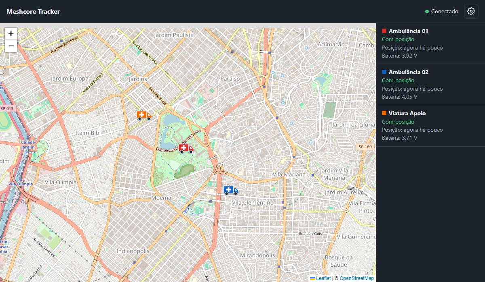

  

<h1 align="center">Meshcore Tracker</h1>

  Pede telemetria com posição de contatos <a href="https://meshcore.co.uk/">MeshCore</a> periodicamente e mostra cada um no mapa.

  
  
  

Basta ligar um rádio companion na USB, escolher os contatos e o intervalo. O programa roda no próprio computador, em janela própria.

## Recursos

- **Automação:** escolha um ou mais contatos e um intervalo de 15 segundos a 5 horas.
- **Mapa:** mostra a última posição de cada contato, com uma cor própria, bateria, altitude e temperatura.
- **Tempo adaptativo:** a espera e o intervalo se ajustam ao tempo de resposta de cada contato, para não sobrecarregar a malha.
- **Recuperação de rota:** depois de 2 falhas seguidas, a rota salva é apagada e o pedido seguinte sai por flood.
- **Conexão:** mostra o nome do dispositivo USB, o status e o tempo conectado ou desconectado, e reconecta sozinho.

## Instalação

Baixe o instalador na página de [versões](https://github.com/tchellow/meshcore-tracker/releases/latest):

| Sistema | Arquivo | Como instalar |
|---|---|---|
| Windows 10 ou 11 (64 bits) | `MeshcoreTracker-<versão>-windows-x64-setup.exe` | Dois cliques no arquivo |
| Ubuntu 22.04 ou mais novo (amd64) | `MeshcoreTracker-<versão>-ubuntu-amd64.deb` | `sudo apt install ./MeshcoreTracker-<versão>-ubuntu-amd64.deb` |

O instalador não exige Python. Os detalhes, inclusive o aviso do Windows SmartScreen, estão em [Instalação](docs/instalacao.md).

## Requisitos

- Rádio MeshCore com firmware **Companion USB**, para o cabo, ou **Companion Bluetooth**. No Windows, o programa pede o PIN e faz o pareamento; no Ubuntu, pareie nas configurações do sistema. Um firmware não responde pela conexão do outro.
- Nos contatos rastreados: permissão para enviar telemetria e localização a este rádio, e GPS com sinal.
- Internet para carregar o mapa.

## Uso rápido

1. Abra o Meshcore Tracker e clique na engrenagem, no canto superior direito.
2. Em **Conexão**, escolha a porta e clique em **Conectar**.
3. Em **Automação**, clique em **Adicionar** nos contatos e escolha o intervalo.
4. Clique em **Voltar ao mapa**.

Fechar a janela encerra o programa, e os pedidos de telemetria param.

## Documentação

- [Instalação](docs/instalacao.md)
- [Guia de uso](docs/uso.md)
- [Como a automação funciona](docs/automacao.md)
- [Solução de problemas](docs/solucao-de-problemas.md)
- [Desenvolvimento](docs/desenvolvimento.md)
- [Histórico de versões](CHANGELOG.md)

## Uso responsável

Cada pedido transmite pela malha, que é compartilhada, e solicita a localização de alguém. Rastreie só os seus nodes ou os de quem autorizou, e evite intervalos curtos por muito tempo.

## Situação dos testes

Com rádio real, foi testado no Windows, usando um ProMicro NRF52840 e dois nodes companion a até 1 hop. No Ubuntu 22.04 e 24.04, a automação do projeto instala o pacote e testa a janela, mas o programa ainda **não foi testado com rádio**. Se você testar, abra uma [issue](https://github.com/tchellow/meshcore-tracker/issues) contando o resultado.

## Licença

Distribuído sob a [GNU GPL versão 3](LICENSE). As bibliotecas usadas estão em [componentes de terceiros](docs/terceiros.md). Este é um projeto independente, sem vínculo oficial com o projeto MeshCore.
