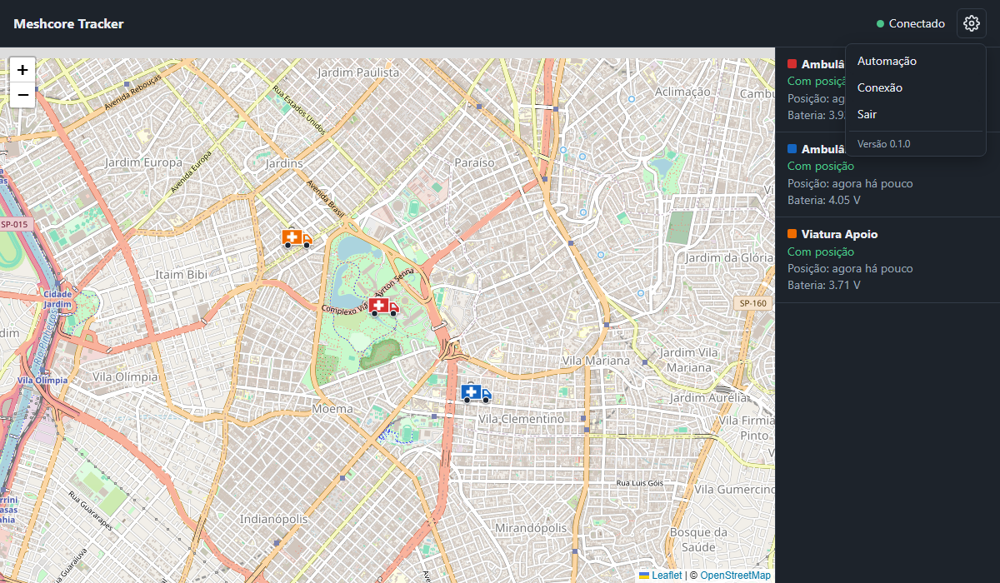
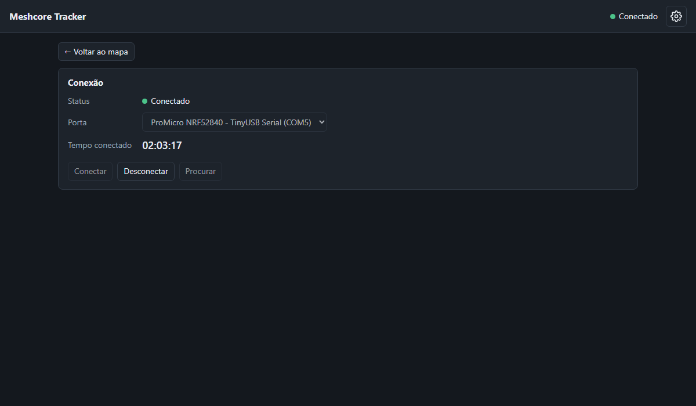
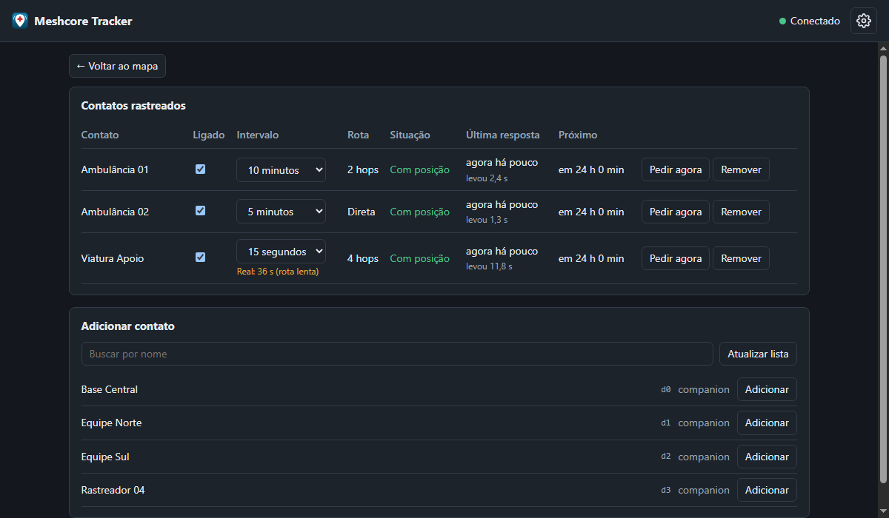

# Guia de uso

As imagens usam contatos e posições fictícios.

## Antes de começar

- Grave o firmware **Companion USB** no rádio ligado ao computador.
- Nos nodes rastreados, autorize o envio de telemetria e localização a este rádio. O contato precisa estar na lista do rádio.
- Feche outros programas que usem a porta, como o MeshCore Web App. Só um programa usa a porta por vez.

## Abrir e encerrar

O programa abre em janela própria. Se você abri-lo de novo, ele só traz para a frente a janela que já está aberta, sem iniciar outra cópia.

**Fechar a janela encerra o programa**, e os pedidos de telemetria param. Você também pode clicar na engrenagem, em **Sair** e em **Confirmar saída**.

Se o sistema não tiver o motor da janela, o programa abre no navegador, em `http://127.0.0.1:8790`. Nesse caso, fechar a aba não o encerra: use **Sair**. Em qualquer modo, ele só aceita acesso do próprio computador.

## Menu da engrenagem

## Conexão

1. Ligue o rádio e clique em **Procurar** se ele não aparecer na lista.
2. Escolha a porta e clique em **Conectar**.

A lista mostra o nome que o dispositivo informa pela USB. Em placas com chip conversor, como CP2102 ou CH340, costuma aparecer o nome do chip, não o do rádio.

O **tempo conectado** conta desde a conexão atual. O **tempo desconectado** conta desde a queda, ou desde que o programa abriu.

Se o cabo sair, o status muda para **Reconectando...** e o programa tenta voltar a cada 15 segundos. Ao abrir de novo, ele usa a última porta que funcionou. Clique em **Desconectar** para interromper isso.

## Automação

1. Em **Adicionar contato**, clique em **Adicionar**. Sem busca, a lista mostra só companions. Busque pelo nome para ver os outros tipos.
2. Escolha o **Intervalo** de cada contato. O padrão é 10 minutos.
3. Use **Ligado** para pausar um contato sem removê-lo.

| Coluna | O que mostra |
|---|---|
| **Intervalo** | O mínimo escolhido. Aparece **Real** em laranja se o contato precisar de mais tempo |
| **Rota** | **Direta**, número de hops ou **Flood** |
| **Situação** | Resultado do último pedido |
| **Última resposta** | Quando respondeu e quanto levou |
| **Próximo** | Quando sairá o próximo pedido |

Situações possíveis:

| Situação | Significado |
|---|---|
| **Com posição** | Respondeu com GPS |
| **Respondeu sem GPS** | Respondeu, mas sem posição. O mapa mantém a última conhecida |
| **Sem resposta** | Não respondeu dentro da espera |
| **Não está no rádio** | O contato saiu da lista do rádio |

Mudar o intervalo ou religar um contato dispara um pedido imediato. **Pedir agora** também faz isso e zera o contador de falhas.

## Mapa

- **Ícone:** cada contato tem uma cor fixa, repetida na lista lateral.
- **Nome:** aparece ao passar o mouse sobre o ícone.
- **Detalhes:** clique no ícone para ver posição, altitude, bateria e outras leituras.
- **Lista lateral:** clique em um contato para centralizar o mapa nele.
- **Posição antiga:** o ícone fica semitransparente quando o contato está desligado, a última tentativa não trouxe posição, ou a posição está antiga.

São 12 cores. A partir do 13º contato ativo ao mesmo tempo, elas se repetem.
